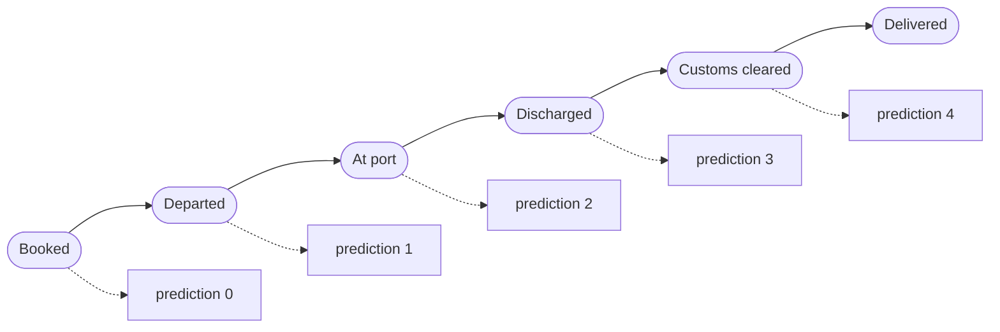
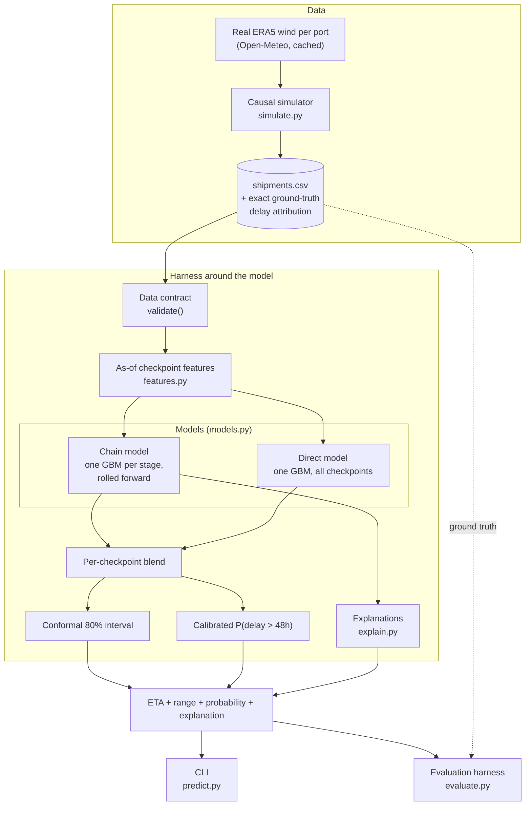
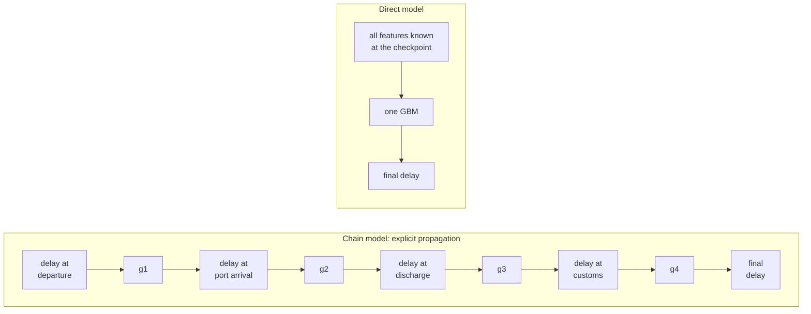
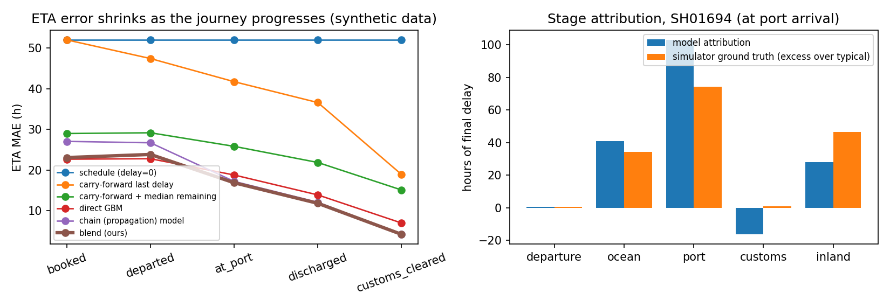
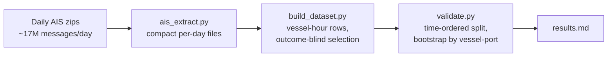

# Shipment ETA & Delay Propagation

A system that predicts a shipment's **final delivery ETA**, the **probability of a serious delay**, and **which stage of the journey
caused it** — and updates all three as the shipment moves from booking to delivery.

Built for the Aiqon AI internship take-home assignment (*Predicting Shipment ETA and Delay Propagation Using AI*).

> **Scope of the evidence.** The main results are on a **synthetic** shipment simulator written for this project (only the port wind
> data is real). They demonstrate the method and make explanation quality *measurable*; they are not a claim of real-world ETA
> accuracy. One narrow stage — port-arrival ETA — is additionally checked on real AIS data ([Real-data check](#real-data-check)).

---

## Contents

- [What it does](#what-it-does)
- [Architecture](#architecture)
- [How delay propagation is modelled](#how-delay-propagation-is-modelled)
- [Preventing leakage: information by checkpoint](#preventing-leakage-information-by-checkpoint)
- [Explanations](#explanations)
- [Results](#results)
- [Real-data check](#real-data-check)
- [Quickstart](#quickstart)
- [Repository layout](#repository-layout)
- [Testing and reproducibility](#testing-and-reproducibility)
- [Limitations](#limitations)

---

## What it does

A shipment passes five milestones. The system makes a fresh prediction at each **checkpoint**, using only what is known at that moment.



Each prediction contains:

| Output | Meaning |
|---|---|
| **ETA** | scheduled delivery + predicted final delay |
| **80% range** | split-conformal interval around the delay |
| **P(delay > 48 h)** | calibrated probability of a serious delay |
| **Stage attribution** | hours gained or lost at each stage versus a typical shipment |
| **Explanation** | one plain-English sentence naming the main drivers |

Example (a held-out shipment, predicted on arrival at port):

```text
Predicted ETA 2024-04-29 10:31 (+158h vs schedule, 80% range +130h to +197h); P(delay > 48h) = 100%.
Biggest contributors: port berth & terminal dwell +79h vs typical (expected; main driver: congestion x low terminal efficiency);
inland delivery +48h vs typical (expected; main driver: missed truck dispatch cut-off);
ocean leg +11h vs typical (already incurred; main driver: long route / transit time);
what-if (indicative): if port berth & terminal dwell had run normally the final delay would be ~115h smaller (incl. knock-on effects).
```

---

## Architecture



| Component | File | Role |
|---|---|---|
| Simulator | `src/aiqon/simulate.py` | Generates journeys from an explicit causal delay model and records the true cause of every delay hour |
| Weather | `src/aiqon/weather.py` | Real daily maximum wind at each port (ERA5 via Open-Meteo), cached to CSV |
| Data contract & features | `src/aiqon/features.py` | Validates schema and timelines; builds one feature row per shipment per checkpoint |
| Models | `src/aiqon/models.py` | `Chain` (propagation), `Direct` (single GBM), `Predictor` (blend, intervals, probability) |
| Explanations | `src/aiqon/explain.py` | Stage attribution, what-if re-roll, TreeSHAP drivers, text template |
| Evaluation | `src/aiqon/evaluate.py` | Baselines, splits, ablations, calibration, bootstrap, attribution fidelity |
| CLI | `src/aiqon/predict.py` | Explained prediction for one shipment from a JSON record |

**Why a harness and not just a model.** The regressor is a small part of the system. What makes the output usable is everything
around it: a data contract that rejects impossible timelines, features that cannot see the future, a ladder of baselines the
model must beat, uncertainty that is calibrated on held-out data, and explanations that are scored against ground truth.

---

## How delay propagation is modelled

Delay is measured as **actual − scheduled** time (hours) at each milestone. A delay does not simply carry forward; part of it is
absorbed by schedule slack, and new delay is added at each stage:

```text
d_k = m_k · d_(k-1) + own_k

d_k    cumulative delay at milestone k
m_k    share of upstream delay that survives (0..1): schedule slack, or a vessel speeding up (at most 24 h recovered)
own_k  new delay created at stage k, from named drivers
```

The simulator implements behaviours that real logistics has, because the assignment asks for realism rather than abstract modelling:

| Behaviour | Where | Effect |
|---|---|---|
| Congestion × terminal inefficiency | Port | Berth queue and dwell grow with congestion and shrink with terminal efficiency |
| Missed berth window | Port | Arriving beyond the slack loses the slot: a discrete +24–48 h jump, not a smooth increase |
| Office hours | Customs | Clearance only Mon–Fri 09:00–17:00, so a weekend discharge waits |
| Inspections and document errors | Customs | Rare, heavy-tailed delays, more likely for high-risk cargo |
| Dispatch cut-off | Inland | Cleared after 15:00 means the truck leaves the next working morning |
| Weather | Departure, ocean | Real wind above a threshold adds delay |
| Informative missing data | All | Timestamps go missing more often at inefficient ports |

Because every driver's hours are logged, the final delay decomposes **exactly** into per-stage contributions. That is the ground
truth used to score explanations — something real data cannot provide.

### Two models, blended



- **Chain model.** One gradient-boosted model per stage predicts that stage's *increment* from the previous stage's delay plus the
  stage's own drivers. Rolling the stages forward from the last observed milestone gives the final delay. Each stage has a separate
  model per *information regime* (booked / departed / at port or later), trained on exactly the inputs that exist at that point.
- **Direct model.** A single gradient-boosted model over all checkpoints, with unobserved values left as missing.
- **Blend.** A weight per checkpoint, chosen on held-out calibration data. The direct model wins early in the journey and the chain
  model wins once stage delays are observed.

---

## Preventing leakage: information by checkpoint

An ETA that uses information from the future is useless in operation, so availability is enforced in code and tested.

| Known at… | Booked | Departed | At port | Discharged | Customs cleared |
|---|:-:|:-:|:-:|:-:|:-:|
| Route, terminal efficiency, cargo risk, document flag | ✓ | ✓ | ✓ | ✓ | ✓ |
| Departure delay, origin wind, congestion on departure day | | ✓ | ✓ | ✓ | ✓ |
| Port-arrival delay, arrival congestion and wind | | | ✓ | ✓ | ✓ |
| Discharge delay | | | | ✓ | ✓ |
| Customs delay | | | | | ✓ |

Anything not yet observed is a missing value — never a future value, and never a forecast standing in for one. An adversarial test
alters everything that happens *after* a checkpoint (later timestamps, later weather, the target itself) and requires the prediction
and its explanation at that checkpoint to stay identical.

Data roles never overlap: **train** fits the models, **calibration half A** sets blend weights, **calibration half B** sets the
conformal interval and probability calibration, and **test** is touched only for the final numbers.

---

## Explanations

| View | Question it answers | How |
|---|---|---|
| **Stage attribution** | Where were the hours lost? | Each stage's increment (realised if the stage is done, expected otherwise) minus the typical increment |
| **What-if** *(indicative)* | What if this stage had run normally? | Re-roll the chain with that stage set to typical, so knock-on effects are credited to their cause |
| **Top driver** | Why did that stage slip? | Largest positive TreeSHAP contribution in that stage's model |
| **Text** | What do I tell the customer? | A fixed template — no language model, so no invented causes |

---

## Results

All figures below are on **synthetic data**, temporal split (train on the earliest 60%, calibrate on 15%, test on the latest 25% =
500 shipments). Complete tables are in [`report/results.md`](report/results.md) and the write-up is [`report/report.pdf`](report/report.pdf).



### ETA error (mean absolute error, hours)

| Method | Booked | Departed | At port | Discharged | Customs cleared | Overall |
|---|--:|--:|--:|--:|--:|--:|
| Schedule as ETA | 52.0 | 52.0 | 52.0 | 52.0 | 52.0 | 52.0 |
| Best baseline (last delay + median remaining) | 29.0 | 29.2 | 25.8 | 21.9 | 15.1 | 24.2 |
| Direct model | 22.7 | 22.8 | 18.8 | 13.9 | 7.0 | 17.0 |
| Chain model | 27.1 | 26.7 | 17.2 | 12.1 | 4.3 | 17.5 |
| **Blend (this system)** | **23.1** | **23.8** | **16.9** | **11.8** | **4.2** | **16.0** |

Overall MAE 16.0 h (95% bootstrap CI 14.7–17.3) against 24.2 h for the best baseline; the paired improvement is 7.1–9.5 h.

### Uncertainty, delay probability and explanations

| Checkpoint | 80% interval coverage | Interval width (h) | AUC, delay > 48 h | Top-1 stage agreement with ground truth |
|---|--:|--:|--:|--:|
| Booked | 0.77 | 86 | 0.82 | 0.48 |
| Departed | 0.80 | 82 | 0.81 | 0.50 |
| At port | 0.82 | 67 | 0.86 | 0.58 |
| Discharged | 0.79 | 34 | 0.91 | 0.71 |
| Customs cleared | 0.87 | 10 | 0.99 | 0.84 |

Chance for top-1 agreement is 0.20. Explanations are weak before departure because the causes have not happened yet.

### Robustness

| Experiment | Result |
|---|---|
| Feature ablation | Removing interaction and calendar features raises the direct model's MAE from 17.0 to 22.1 h — the largest effect |
| 300-shipment subset (assignment size) | MAE 16.7 h vs 24.2 h baseline, but a wide interval (13.5–21.1) and unreliable calibration |
| Route hold-out (two routes never seen) | MAE 22.3 h vs 33.0 h baseline; interval coverage falls to 0.62–0.78 |
| Three independent simulated worlds | Blend MAE 16.9 ± 1.1 h vs baseline 25.8 ± 2.0 h |

### What did not work, stated plainly

- The **blend's edge over the direct model alone is about one hour** and is not uniform: in one simulated world it was no better.
- The **chain model has a known mismatch**: it is trained on the true previous-stage delay but receives a predicted one at inference.
  A principled fix was implemented and tested on validation data; it was not better, so it is switched off and documented.
- **Interval coverage degrades on unseen routes**, and the calibrated delay probability is no better calibrated than the raw classifier.
- The **what-if view is not validated** against true counterfactuals; its magnitudes are indicative only.

---

## Real-data check

A separate track in [`realworld/`](realworld/) tests **one stage only** — port-arrival ETA — on real data: 24 consecutive days of
[Danish Maritime Authority open AIS](https://www.dma.dk/safety-at-sea/navigational-information/ais-data), in which vessels broadcast their own declared destination and ETA. The question is whether a
model can correct that declared ETA. It does **not** validate customs, delivery, or the propagation model above.



| Arrival radius | Declared ETA | Per-port median correction | Distance / speed | LightGBM | LightGBM vs declared (95% CI) | LightGBM vs median correction (95% CI) |
|---|--:|--:|--:|--:|--:|--:|
| 5 km | 11.46 h | 7.97 h | 14.03 h | 7.41 h | +2.75 to +5.41 h | −0.96 to +2.14 h |
| 10 km | 7.27 h | 6.50 h | 10.20 h | 5.59 h | +1.11 to +2.25 h | +0.45 to +1.37 h |
| 15 km | 5.97 h | 5.32 h | 8.81 h | 4.26 h | +1.28 to +2.17 h | +0.76 to +1.41 h |

MAE in hours on the latest 20% of the period (~30,000 vessel-hour rows, 27 ports, ~340 test vessel-port pairs).

**Reading it honestly.** The gain over the declared ETA is real but modest (about 1.5–2 h) and depends on how "arrival" is defined.
Against a trivial per-port median correction the model wins by at most about one hour, and at 5 km it is not distinguishable.
The declared ETA is already good in the typical case (median error ≈ 1.5 h); the error is driven by stale ETAs and no-shows.
A physics-only ETA is worse than the declared one, and the model is far weaker on vessels it has not seen.

**A first design was retracted.** Keeping only vessels that *did* arrive within a fixed window showed a much larger gain
(12.75 h vs 24.63 h). A sensitivity check revealed the error scaled with the window length — the selection leaked the outcome.
The current design selects rows using only information known at prediction time and keeps vessels that never arrive.
Details: [`realworld/README.md`](realworld/README.md). Data source: [Danish Maritime Authority, AIS data](https://www.dma.dk/safety-at-sea/navigational-information/ais-data).

---

## Quickstart

Requires Python 3.13.

```bash
pip install -r requirements.txt

# 1. Simulate, train, evaluate (about one minute)
python scripts/run_all.py

# 2. Run the tests
python -m pytest tests realworld -q

# 3. Explain one shipment
PYTHONPATH=src python -m aiqon.predict examples/at_port_extreme.json
```

On Windows PowerShell use `$env:PYTHONPATH="src"; python -m aiqon.predict examples/at_port_extreme.json`.

The first run downloads real wind data from the free Open-Meteo archive API and caches it in `data/wind_daily.csv`.

### Input format

A shipment is a JSON record with scheduled times, the actual timestamps known so far (`null` when not yet known), and static fields.
The checkpoint is inferred from the latest known milestone. See [`examples/`](examples/).

```json
{
  "origin": "Nhava Sheva", "dest": "Rotterdam", "transshipment": 0,
  "sched_departure": "2024-04-01 08:00:00", "sched_port_arrival": "2024-04-26 08:00:00",
  "sched_discharge": "2024-04-28 08:00:00", "sched_customs": "2024-04-29 20:00:00", "sched_delivery": "2024-04-30 20:00:00",
  "act_departure": "2024-04-01 14:30:00", "act_port_arrival": null, "act_discharge": null, "act_customs": null,
  "dest_efficiency": 0.75, "cong_at_departure": 0.41, "wind_origin_dep": 24.0,
  "customs_risk": 0.18, "docs_flag": 0
}
```

Records with missing required fields or timelines that run backwards are rejected with an explicit error.

### Outputs of the pipeline

| File | Content |
|---|---|
| `report/results.md` | Every table: MAE, coverage, probability metrics, attribution fidelity, ablations, replications |
| `report/fig_main.png` | Error-by-checkpoint curve and an example attribution |
| `report/run_metadata.json` | Seeds, model parameters, split definition, package versions |
| `models/predictor.pkl` | Trained predictor used by the CLI |
| `report/archive/` | Previous outputs, archived rather than overwritten |

Two further scripts document investigations of the chain model: `scripts/chain_fix_effect.py` and `scripts/chain_dprev_mismatch.py`.

---

## Repository layout

```text
src/aiqon/          core package
  simulate.py         causal shipment simulator with exact ground truth
  weather.py          real ERA5 wind per port
  features.py         data contract and as-of checkpoint features
  models.py           chain model, direct model, blended predictor
  explain.py          attribution, what-if, drivers, text
  evaluate.py         baselines, splits, metrics, ablations
  predict.py          command-line interface
scripts/            run_all.py and two chain-model investigations
tests/              13 tests for the synthetic pipeline
realworld/          AIS port-arrival validation: extractor, port map, dataset builder, validation, 10 tests
examples/           four sample shipments
report/             report.pdf, results.md, figures, run metadata, pre-audit baseline
data/               generated shipments and cached wind
```

---

## Testing and reproducibility

23 tests, none of which need the network:

| Area | What is checked |
|---|---|
| Leakage | Features and predictions at a checkpoint are unchanged when everything after it is altered |
| Availability | Each feature is missing until its checkpoint is reached |
| Consistency | Training and inference use the same columns in the same order for every information regime |
| Simulator | Stage contributions sum exactly to the final delay |
| Robustness | Missing intermediate timestamps, invalid and backwards timelines, incomplete input records |
| Methodology | Temporal and route splits are isolated; calibration data is separate from fitting data |
| Uncertainty | Intervals are ordered, coverage is near nominal, probability rises with predicted delay |
| Determinism | Identical results under fixed seeds |
| Real-data track | Arrival detection, outcome-blind row selection, censoring, purged time split |

Dependencies are pinned in `requirements.txt`. Training is deterministic, and two consecutive full pipeline runs produced
byte-identical `results.md`.

---

## Limitations

- **Synthetic data.** Terminal-efficiency tiers, congestion dynamics, effect sizes, the 48 h threshold and the missing-data pattern
  are assumptions. The models partly learn the simulator's own rules, so absolute errors do not predict real-world accuracy.
- **No end-to-end real validation.** The only real-data evidence is the port-arrival check, on one region and 24 days. No public
  source links departure, port, customs and delivery for the same shipment, so the propagation model itself is untested on real shipments.
- **Distribution shift.** Conformal intervals assume conditions like those seen in calibration and lose coverage on unseen routes.
- **Known model gap.** The chain model's train/inference mismatch on the previous-stage delay is unresolved.
- **Next step.** Linked shipment milestones from a carrier or forwarder, ingested through the same data contract.
